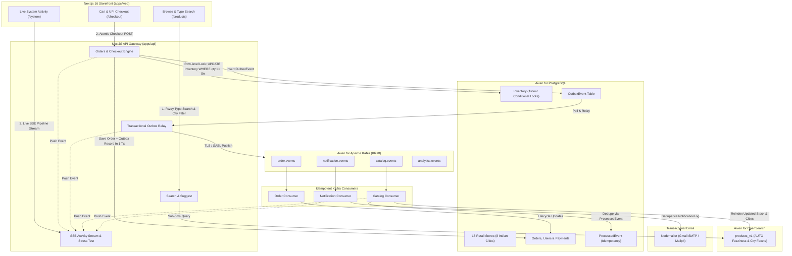

# AetherMart — Event-Driven Omnichannel Retail Platform

Full-stack omnichannel e-commerce platform built for a physical retail store chain across India transitioning online. Powered by **Next.js 16**, **NestJS 12**, **Aiven for PostgreSQL**, **Aiven for Apache Kafka (KRaft)**, and **Aiven for OpenSearch**.

---

## Architecture Diagram



---

## Key Hackathon Highlights

- **Typo-Tolerant Search (`Aiven for OpenSearch`)**: Handles aggressive misspellings like `"bluetoth"` (Bluetooth earphones), `"samsng"` (Samsung phones), and `"mobail"` (mobiles) with `fuzziness: "AUTO"` in sub-5ms with real-time city aggregation facets.
- **Atomic Oversell Protection (`Aiven for PostgreSQL`)**: Single conditional update `UPDATE "Inventory" SET quantity = quantity - $n WHERE "productId" = $p AND "storeId" = $s AND quantity >= $n` inside an interactive transaction. 100 concurrent buyers competing for 5 units results in exactly 5 orders and zero negative stock.
- **Physical Store Inventory Across India**: 16 retail branches across Mumbai, Pune, Delhi, Bengaluru, Hyderabad, Chennai, Kolkata, and Ahmedabad. Checkout reserves stock from local city stores.
- **Transactional Outbox & Idempotency (`Aiven for Apache Kafka`)**: No ghost orders and no dropped events. Every consumer checks the `ProcessedEvent` unique table to guarantee replay safety.
- **Live System Activity Monitor (`/system`)**: Real-time SSE stream visualizing each step from PostgreSQL save to Kafka publication, consumer receipt, OpenSearch doc update, and email delivery. Includes an interactive **100-Concurrent-Buyer Stress Test Button**.

For step-by-step instructions:
- 📖 [DEMO.md](file:///c:/Users/Ayush%20Tiwari/Desktop/freelance/e-commerce/DEMO.md) — Click-by-click judging demo script.
- 🎤 [PITCH.md](file:///c:/Users/Ayush%20Tiwari/Desktop/freelance/e-commerce/PITCH.md) — 2-minute hackathon pitch outline.

---

## Quick Start

1. **Start infrastructure (Docker Desktop / WSL2)**:
   ```bash
   docker compose up -d
   ```
   Services started:
   - PostgreSQL: `localhost:5432`
   - Kafka (KRaft): `localhost:9092`
   - OpenSearch: `http://localhost:9200`
   - Mailpit SMTP & Web UI: `localhost:1025` / `http://localhost:8025`
   - Optional Kafka UI: `docker compose --profile tools up -d` (`http://localhost:8080`)

2. **Install dependencies & configure env**:
   ```bash
   npm install
   cp .env.example .env
   ```
   - **Gmail SMTP (Nodemailer)**: Enable 2-Step Verification on your Google account, generate a 16-character **App Password**, and set `SMTP_USER="you@gmail.com"`, `SMTP_PASS="your-app-password"`, and `SMTP_FROM="AetherMart <you@gmail.com>"` in `.env` (keep `SMTP_SERVICE="gmail"`, `SMTP_HOST="smtp.gmail.com"`, `SMTP_PORT=465`, `SMTP_SECURE=true`).
   - *(Optional)* Add `GOOGLE_CLIENT_ID` and `GOOGLE_CLIENT_SECRET` in `.env` with authorized redirect URI `http://localhost:4000/api/auth/google/callback` to enable live Google Sign-In.

3. **Push Prisma schema & seed sample catalog**:
   ```bash
   npm run db:generate
   npm run db:push
   npm run db:seed
   ```

4. **Start frontend + backend**:
   ```bash
   npm run dev
   ```
   - Storefront: `http://localhost:3000`
   - API: `http://localhost:4000/api/health`
   - Mailpit Email Inbox: `http://localhost:8025`

## Seeded Accounts & Promo Codes

- **Customer**: `customer@aethermart.local` / `Customer@12345`
- **Admin**: `admin@aethermart.local` / `Admin@12345`
- **Promo Codes**: `WELCOME10`, `FLAT500`, `UPIFIRST`

## Run against Aiven

The application runs seamlessly against managed cloud infrastructure on **Aiven** (Aiven for PostgreSQL, Aiven for Apache Kafka, and Aiven for OpenSearch) without requiring any local Docker containers running.

### 1. Provision Services in Aiven Console
1. **Aiven for PostgreSQL**: Note the Service URI (includes `sslmode=require`).
2. **Aiven for Apache Kafka**:
   * Enable SASL authentication (SCRAM-SHA-256) or download the Project CA certificate (`ca.pem`).
   * Note the Service URI / host:port.
3. **Aiven for OpenSearch**: Note the HTTPS Service URI and credentials (`avnadmin` + password).

### 2. Configure Environment (`.env`)
Update your `.env` file with your Aiven credentials:

```bash
# Aiven for PostgreSQL
DATABASE_URL="postgres://avnadmin:<password>@<pg-host>:<pg-port>/defaultdb?sslmode=require"

# Aiven for Apache Kafka (SASL/SCRAM example)
KAFKA_BROKERS="<kafka-host>:<kafka-port>"
KAFKA_SSL=true
KAFKA_SASL_MECHANISM="scram-sha-256"
KAFKA_USERNAME="avnadmin"
KAFKA_PASSWORD="<kafka-password>"
KAFKA_CA_PATH="./certs/ca.pem"      # optional if using public CA
KAFKA_PARTITIONS=3
KAFKA_REPLICATION_FACTOR=1

# Aiven for OpenSearch
OPENSEARCH_NODE="https://<opensearch-host>:<opensearch-port>"
OPENSEARCH_USERNAME="avnadmin"
OPENSEARCH_PASSWORD="<opensearch-password>"
OPENSEARCH_PRODUCTS_INDEX="products_v1"
```

### 3. Initialize Database, Kafka Topics & Search Index
Run the automated initialization scripts against Aiven:

```bash
# 1. Push schema and seed catalog into Aiven PostgreSQL
npm run db:push
npm run db:seed

# 2. Idempotently create Kafka topics on Aiven Kafka
npm run kafka:setup

# 3. Create OpenSearch mapping and reindex products from Aiven PostgreSQL
npm run opensearch:reindex
```

### 4. Start the Application
```bash
npm run dev
```
Both the storefront (`http://localhost:3000`) and API (`http://localhost:4000`) will now run entirely on Aiven cloud services.

---

## Verification Commands

```bash
npm run build
npm test
```

